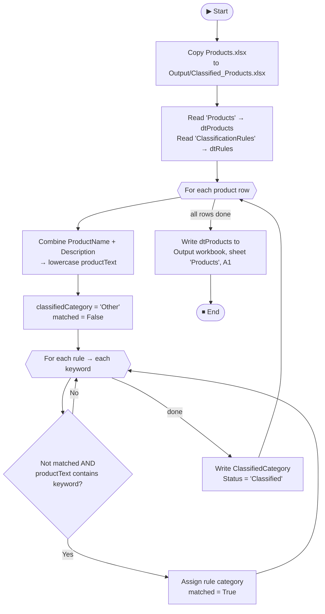

<div align="center">

# 📊 Excel Product Classifier

### Rule-based product categorization, automated with UiPath


*Stop reviewing products by hand. Define keyword rules in Excel, run the bot, get a classified workbook.*

[Overview](#-overview) •
[Features](#-features) •
[How It Works](#-how-it-works) •
[Workbook Format](#-excel-workbook-format) •
[Getting Started](#-getting-started) •
[Limitations](#-limitations--roadmap) •
[Troubleshooting](#-troubleshooting)

</div>

---

## 📖 Overview

**Excel Product Classifier** is a UiPath RPA project that automates a repetitive product-categorization task. It reads product data from an Excel workbook, matches each product against configurable keyword rules, assigns a category, and writes the results to a separate output workbook.

The workflow combines each product's name and description into searchable text, compares it against rules stored in Excel, assigns the **first matching category**, and updates the processing status, so the result is visible right in the spreadsheet.

> 💡 **Core UiPath concepts demonstrated:** Excel automation, DataTables, nested loops, conditional logic, variables, file operations, and writing processed data to an output workbook.

---

## ✨ Features

| | Feature |
|---|---|
| 📥 | Reads product records from the `Products` worksheet |
| 📐 | Reads configurable rules from the `ClassificationRules` worksheet |
| 🔗 | Combines product name + description into one searchable text |
| ✂️ | Splits comma-separated keywords and checks each for a match |
| 🥇 | Assigns the category of the **first matching rule** |
| 🧩 | Falls back to `Other` when nothing matches |
| ✅ | Updates `ClassifiedCategory` and `Status` in the DataTable |
| 📋 | Copies the source workbook first, so the original is never modified |
| 📤 | Writes the processed table to the output workbook |

---

## 🛠️ Technology Stack

| Layer | Technology |
|---|---|
| **Automation platform** | UiPath Studio |
| **Workflow** | `Main.xaml` |
| **Input / output format** | Microsoft Excel `.xlsx` |
| **Data processing** | UiPath DataTables + VB.NET expressions |
| **Classification approach** | Rule-based keyword matching |

---

## 📁 Project Structure

```text
Excel-Product-Classifier/
├── 📄 Main.xaml                      # The workflow
├── ⚙️ project.json                   # UiPath project configuration
├── 📂 Data/
│   └── 📗 Products.xlsx              # Input workbook
├── 📂 Output/
│   └── 📗 Classified_Products.xlsx   # Generated results
└── 📝 README.md
```

> **Note:** The exact structure may differ depending on how the project is organized locally. Keep the input workbook in `Data/` and make sure `Output/` exists before running.

---

## ⚙️ How It Works



<details>
<summary><b>📝 Step-by-step breakdown</b></summary>

<br/>

1. **Copy the source workbook**
   Copies `Data/Products.xlsx` to `Output/Classified_Products.xlsx` with overwrite enabled.

2. **Read the source data**
   Reads the `Products` worksheet into `dtProducts` and `ClassificationRules` into `dtRules`.

3. **Prepare product text**
   For each product, combines `ProductName` and `Description`, then converts the text to lowercase.

4. **Initialize the result**
   Each product starts with `classifiedCategory = "Other"` and `matched = False`.

5. **Evaluate rules**
   Iterates through each rule and its comma-separated keywords. On a match, assigns the rule's category and sets `matched = True`. The condition stops later keywords from replacing the first match.

6. **Update the DataTable**
   Writes the selected category to `ClassifiedCategory` and sets `Status` to `Classified`.

7. **Write the output workbook**
   Writes the updated `dtProducts` to the `Products` worksheet in `Output/Classified_Products.xlsx`, starting at cell `A1`.

</details>

---

## 📗 Excel Workbook Format

The input workbook must contain two worksheets.

### 1️⃣ `Products`

| Column | Purpose |
|---|---|
| `ProductID` | Unique identifier for the product |
| `ProductName` | Product name used for classification |
| `Category` | Optional / source category field |
| `Price` | Product price |
| `Stock` | Available inventory quantity |
| `Description` | Additional text used for classification |
| `ClassifiedCategory` | Category assigned by the bot |
| `Status` | Processing status assigned by the bot |

> ⚠️ The workflow expects the headers `ProductName`, `Description`, `ClassifiedCategory`, and `Status` to exist. If you rename them, update the matching expressions in `Main.xaml`.

### 2️⃣ `ClassificationRules`

| Column | Purpose |
|---|---|
| `Category` | Category to assign when a rule matches |
| `Keywords` | Comma-separated keywords associated with the category |
| `Priority` | Informational only. The workflow uses **worksheet row order**, not this column |

**Example rules:**

| Category | Keywords | Priority |
|---|---|---:|
| Electronics | `mouse,keyboard,charger,headphones,bluetooth,usb,ssd,monitor,laptop,led` | 1 |
| Furniture | `chair,desk,table,stand,furniture` | 2 |
| Clothing | `shirt,t-shirt,shoes,jacket,pants,clothing,cotton` | 3 |
| Books | `book,python,programming,novel,textbook` | 4 |
| Other | *(leave blank)* | 99 |

Edit the keyword lists to customize the classifier. No code changes needed.

---

## 🔍 Classification Logic

The classifier uses simple **substring matching**:

```vb
Not matched AndAlso currentKeyword.Trim <> "" AndAlso productText.Contains(currentKeyword.Trim)
```

Easy to read and easy to extend, but not semantic or ML-based. Two things to keep in mind:

> 🥇 **Rule order matters.** The first matching rule wins. `Priority` is not applied unless you implement sorting by it.
>
> ⚠️ **Substrings can cause false positives.** For example, `led` also matches "sched**uled**", and `stand` also matches "**stand**ard".

---

## 🚀 Getting Started

### Prerequisites

- ✅ UiPath Studio with the **Excel activities** package installed
- ✅ A valid `.xlsx` input workbook with the `Products` and `ClassificationRules` sheets
- ✅ An existing `Output/` directory
- ✅ Write permission for the project directory
- ✅ Input and output workbooks **closed** in Excel (locked files will fail)

### Run it

1. **Clone** or download this repository.
2. **Open** the project in UiPath Studio.
3. **Place** the input workbook at `Data/Products.xlsx`.
4. **Confirm** that `Output/` exists.
5. **Verify the Copy File activity:**

   | Setting | Value |
   |---|---|
   | Source | `Data\Products.xlsx` |
   | Destination | `Output\Classified_Products.xlsx` |
   | Overwrite | `True` |

6. **Verify the Write Range Workbook activity:**

   | Setting | Value |
   |---|---|
   | Workbook path | The output file path, e.g. `outputFile` |
   | Sheet | `Products` |
   | Starting cell | `A1` |
   | DataTable | `dtProducts` |

7. **Make sure** the `outputFile` variable resolves to the same path as the Copy File destination.
8. **Save and run** `Main.xaml` ▶️
9. **Open** `Output/Classified_Products.xlsx` and inspect the `Products` worksheet.

---

## 📤 Output

The output workbook keeps the copied workbook structure and updates the `Products` worksheet:

- **`ClassifiedCategory`** holds the category assigned by the rule matcher.
- **`Status`** is set to `Classified` for every processed row.
- All original product fields are retained and written back alongside the results.

The `ClassificationRules` and `README` worksheets stay in the output workbook, because the source workbook is copied before the updated `Products` sheet is written.

---

## 🚧 Limitations & Roadmap

### Current limitations

- Uses substring keyword matching, not NLP or machine learning
- First matching rule wins; rules are evaluated in worksheet order
- The `Priority` column is not applied automatically
- Every processed row gets `Status = Classified`, including rows that fall back to `Other`
- Required columns and worksheets must exist
- No confidence score or detailed per-row error status

### Planned improvements

- [ ] Sort rules by `Priority` before classification
- [ ] Use whole-word matching to reduce false positives
- [ ] Distinguish `Classified`, `Unclassified`, `Invalid`, and `Error` statuses
- [ ] Validate required columns, product IDs, prices, and stock values
- [ ] Add logging and Try Catch exception handling
- [ ] Add a timestamp and classification method to each result
- [ ] Add test cases for overlapping keywords and unmatched products
- [ ] Parameterize paths through UiPath arguments or a config file

---

## 🩺 Troubleshooting

<details>
<summary><b>❌ Input workbook cannot be opened</b></summary>

<br/>

- Confirm that `Data/Products.xlsx` exists
- Confirm the filename and extension match the configured path
- Close the workbook in Microsoft Excel
- Check file permissions and OneDrive sync status

</details>

<details>
<summary><b>❌ Copy File says the destination already exists</b></summary>

<br/>

- Ensure the Copy File activity has `Overwrite = True`
- Close the output workbook in Excel if it is open

</details>

<details>
<summary><b>❌ Output workbook is unchanged</b></summary>

<br/>

- Confirm the Copy File activity runs **before** processing
- Confirm `dtProducts` is the output DataTable of the first Read Range
- Confirm Write Range Workbook targets `Output/Classified_Products.xlsx`, not the input file
- Confirm `outputFile` resolves to exactly the same path as the Copy File destination
- Check the UiPath **Output** and **Errors** panels

</details>

<details>
<summary><b>❌ Categories are unexpected</b></summary>

<br/>

- Review the keywords and the **row order** in `ClassificationRules`
- Remember that substring matching can hit unintended text
- Ensure the `ProductName` and `Description` column names match exactly

</details>

---

## 📄 License

No license has been added yet. Add a `LICENSE` file if you intend to distribute this project publicly. Until one is included, others do not have permission to reuse the code.

---

<div align="center">

⭐ If you found this project useful, consider giving it a star!

</div>
