<div align="center">

# 🗂️ File Organizer

### Tidy your Downloads folder automatically, powered by UiPath


*Moves every file into a category subfolder based on its extension, skips partial downloads, and never overwrites anything.*

[How It Works](#-how-it-works) •
[File Types](#-file-type-mapping) •
[Skipped Files](#-skipped-files) •
[Running It](#-running-it) •
[Project Structure](#-project-structure) •
[Roadmap](#-limitations--ideas)

</div>

---

## 📖 Overview

A UiPath Studio process that tidies a folder (by default your **Downloads** folder) by moving each file into a category subfolder based on its extension.

```text
Downloads\
└── Organized\
    ├── 📕 PDF\
    ├── 📘 Word\
    ├── 📗 Excel\
    ├── 📙 PowerPoint\
    ├── 🖼️ Photos\
    ├── 🗜️ Archives\
    ├── 💿 Installers\
    ├── 📄 Text\
    └── 📦 Other\
```

---

## ✨ Highlights

| | Feature |
|---|---|
| 🛡️ | **Never overwrites.** Name collisions become `name (1).ext`, `name (2).ext`, and so on |
| ⏭️ | **Skips** in-progress downloads, temp files, and hidden files |
| 🧯 | **Fault tolerant.** Each file has its own Try Catch, so one locked file doesn't stop the batch |
| 🔒 | **Validates first.** A missing source folder stops the run before anything is created or moved |
| 📊 | **Summary report** with totals for moved, renamed, skipped, and failed files |
| 🔠 | **Case-insensitive** extension matching (`.PDF` = `.pdf`) |

---

## 📋 Requirements

- **UiPath Studio 2026.x** (created with Studio 26.0, Windows target framework, VB expressions)
- Package dependencies, restored automatically by Studio:

| Package | Version | Note |
|---|---|---|
| `UiPath.System.Activities` | 26.6.3 | Used by the workflow |
| `UiPath.FTP.Activities` | 3.1.1-preview | Listed in `project.json`, but the workflow doesn't use it yet |

---

## ⚙️ How It Works

```mermaid
flowchart TD
    A([▶ Start]) --> B[Configure paths<br/>SourceFolder · OrganizedFolder]
    B --> C{Source folder<br/>exists?}
    C -- No --> X[/Log error +<br/>DirectoryNotFoundException/]
    C -- Yes --> D[Create Organized + 9 category folders<br/>existing ones are left alone]
    D --> E{{For each file in top level}}
    E --> F{Partial / temp /<br/>hidden?}
    F -- Yes --> S[Skip + count]
    F -- No --> G[Classify by lower-cased extension<br/>Switch]
    G --> H{Destination<br/>file exists?}
    H -- Yes --> I[Rename to name &#40;n&#41;.ext]
    H -- No --> J[Move File]
    I --> J
    J --> E
    S --> E
    E -- done --> K[📊 Log summary<br/>Warn level if any failed]
    K --> L([⏹ End])
```



<details>
<summary><b>📝 Step-by-step breakdown</b></summary>

<br/>

1. **Configure paths.** `SourceFolder` is set to `C:\Users\ASUS\Downloads`. `OrganizedFolder` is `SourceFolder\Organized`.
2. **Validate the source folder.** If `SourceFolder` doesn't exist, the workflow logs an error and stops with a `DirectoryNotFoundException`. It creates no folders and moves nothing.
3. **Create the destination folders.** It creates `Organized` and the nine category folders. Folders that already exist are left alone.
4. **Process each file.** Only the top level of the source folder is scanned, so files already in `Organized\` are never touched again. For each file:
   - **Skip** partial downloads, temp files, and hidden files (see [Skipped Files](#-skipped-files)).
   - **Classify** the file by its lower-cased extension in a `Switch`.
   - **Resolve name collisions.** If the destination file already exists, the new file is renamed to `name (1).ext`, `name (2).ext`, and so on. Existing files are never overwritten.
   - **Move** the file. Each file runs inside its own Try Catch, so one failure (for example a file locked by another program) is logged and counted, and the rest of the batch keeps going.
5. **Report a summary.** A final Log Message gives totals. If any file failed, the summary is logged at **Warn** level so it stands out.

</details>

### 📊 Example summary

```text
File Organizer finished. Total: 42 | Moved: 39 (renamed to avoid overwrite: 3) | Skipped: 2 | Failed: 1
```

---

## 🧩 File Type Mapping

| Folder | Extensions |
|---|---|
| 📕 `PDF` | `.pdf` |
| 📘 `Word` | `.doc` `.docx` `.rtf` `.odt` |
| 📗 `Excel` | `.xls` `.xlsx` `.xlsm` `.csv` `.ods` |
| 📙 `PowerPoint` | `.ppt` `.pptx` `.odp` |
| 🖼️ `Photos` | `.jpg` `.jpeg` `.png` `.gif` `.bmp` `.webp` `.tif` `.tiff` `.svg` `.heic` |
| 🗜️ `Archives` | `.zip` `.rar` `.7z` `.tar` `.gz` `.tgz` `.bz2` `.xz` |
| 💿 `Installers` | `.exe` `.msi` `.msix` |
| 📄 `Text` | `.txt` `.log` `.md` `.json` `.xml` |
| 📦 `Other` | Anything else, including files with no extension |

> 💡 Matching ignores case, so `.PDF` and `.pdf` are treated the same. A compound extension like `.tar.gz` is matched on its last part (`.gz`), so it still goes to `Archives`.

<details>
<summary><b>➕ Adding a new extension</b></summary>

<br/>

In `Main.xaml`, open:

**For Each File in Folder → Process File Safely → Skip Partial / Hidden Files → Else → Choose Category By Extension (Switch)**

Then:

1. Add a case whose key is the lower-case extension with its leading dot (for example `.epub`).
2. Assign `DestinationFolder` to `System.IO.Path.Combine(OrganizedFolder, "<Folder>")`.
3. If you're introducing a **new folder name**, add a matching **Create Folder** activity near the top of the workflow.

</details>

---

## ⏭️ Skipped Files

These files stay where they are and are counted as **Skipped**:

| Rule | Why |
|---|---|
| Extension `.crdownload`, `.part`, `.partial`, `.tmp`, `.download` | Downloads still in progress. Moving them would break the download |
| `desktop.ini` | Windows folder settings file |
| Files with the **Hidden** attribute | System or app-managed files the user doesn't normally see |

---

## 🚀 Running It

1. Open the project folder in UiPath Studio (`project.json` / `Main.xaml`).
2. **Test with a sample folder first** (see below).
3. Press **Run** (or **Debug**) on `Main.xaml`.
4. Read the result in the **Output** panel. Every moved, skipped, renamed, and failed file gets its own log line, followed by the final summary line.

### 🧪 Test safely before touching Downloads

> ⚠️ **Move File** takes each file out of its original location. Before running against your real Downloads folder, point the workflow at a throwaway folder.

<details open>
<summary><b>Test procedure</b></summary>

<br/>

**1. Create sample files** (PowerShell):

```powershell
$t = "$env:USERPROFILE\Desktop\OrganizerTest"
New-Item -ItemType Directory -Force $t | Out-Null
"a.pdf","b.docx","c.xlsx","d.pptx","e.jpg","f.webp","g.7z","h.rar","i.json","j.log","k.md","l.xml","m.exe","n.unknown","partial.crdownload" |
  ForEach-Object { New-Item -ItemType File -Force (Join-Path $t $_) | Out-Null }
```

**2.** In `Main.xaml`, change **Set Source Folder (Assign)** to that path (for example `"C:\Users\ASUS\Desktop\OrganizerTest"`).

**3.** Run the workflow and check that each file landed in the expected folder and that `partial.crdownload` was skipped.

**4.** Create `a.pdf` in the test folder again and re-run. It should be moved as `Organized\PDF\a (1).pdf`, and the summary should report 1 renamed file.

**5.** Set **Set Source Folder** back to `"C:\Users\ASUS\Downloads"` when you're satisfied.

</details>

---

## 📁 Project Structure

| Path | Purpose |
|---|---|
| 📄 `Main.xaml` | The organizer workflow (entry point) |
| ⚙️ `project.json` | UiPath project definition and package dependencies |
| 🚪 `entry-points.json` | Declares `Main.xaml` as the process entry point |
| 🧱 `project.uiproj` | Studio project file |
| 🗃️ `.settings/` `.project/` `.objects/` `.entities/` `.templates/` `.tmh/` | Studio-managed metadata |
| 🚫 `.local/` | Local Studio cache. **Don't commit it** |

---

## 🚧 Limitations & Ideas

### Current limitations

- **Subfolders aren't processed.** Only top-level files are organized, and folders in Downloads are left as they are.
- **The source path is hard-coded.** To run it on other machines or from Orchestrator, turn `SourceFolder` into an `In` argument or an Orchestrator asset.
- **Moves can't be undone automatically.** Every move is logged, though, so you can trace where a file went.

### Possible improvements

- [ ] Parameterize `SourceFolder` as an `In` argument or Orchestrator asset
- [ ] Schedule it with a time trigger
- [ ] Add date-based subfolders (for example `Photos\2026-10`)
- [ ] Write the summary to a CSV/Excel report

---

<div align="center">

⭐ If this saved you from a messy Downloads folder, consider giving it a star!

</div>
