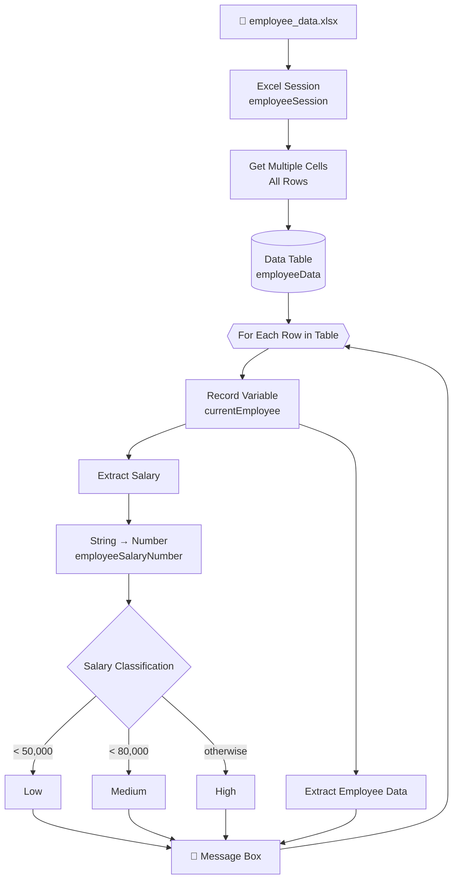
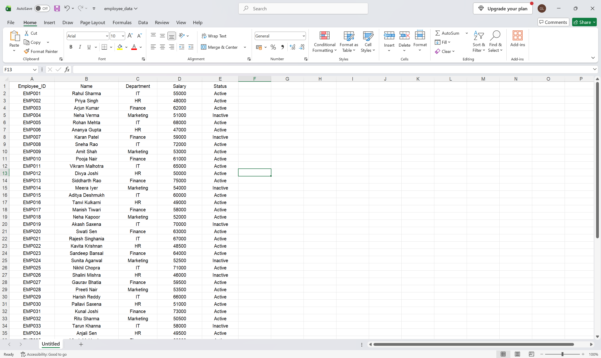

<div align="center">

# 👥 Excel Data Reader & Salary Classifier

### AA-01 · Automation Anywhere Automation 360


*Read employee records from Excel, convert salaries to numbers, classify them with business rules, and display every processed record.*

[Overview](#-overview) •
[Input & Output](#-input--output) •
[Architecture](#-architecture) •
[Step-by-Step](#-step-by-step-processing) •
[Screenshots](#-screenshots) •
[Roadmap](#-limitations--roadmap)

</div>

---

## 📖 Overview

**AA-01** is a Level 1 Automation Anywhere project focused on structured Excel data processing.

The bot reads employee records from an Excel workbook, stores them in a **Data Table**, iterates through each row using a **Record variable**, converts salary values to numeric type, applies salary-based classification rules, and displays the processed result.

It demonstrates the core building blocks of larger RPA workflows: data extraction, structured variables, iteration, type conversion, conditional logic, and result presentation.

---

## 🎯 Objectives

| | Objective |
|---|---|
| 📥 | Read structured data from Excel |
| 🗃️ | Store tabular data in Data Table variables |
| 🔁 | Iterate through individual records |
| 🏷️ | Access fields by column name with Record variables |
| 🔢 | Convert values between data types |
| ⚖️ | Apply deterministic business rules |
| 💬 | Present the processed results |
| 📁 | Organize an RPA project in a maintainable repository |

---

## 🛠️ Technology Stack

| Technology | Purpose |
|---|---|
| **Automation Anywhere Automation 360** | RPA platform |
| **Microsoft Excel** | Input data source |
| **Data Table** | Stores the extracted worksheet data |
| **Record Variable** | Represents the employee currently being processed |
| **Iterator Loop** | Processes records sequentially |
| **Conditional Logic** | Applies salary classification rules |

---

## 📥 Input & Output

### Input

The bot reads this workbook, treating the first row as the header:

```text
input/employee_data.xlsx
```

| Field | Description |
|---|---|
| `Employee_ID` | Unique employee identifier |
| `Name` | Employee name |
| `Department` | Employee department |
| `Salary` | Employee salary |
| `Status` | Current employment status |

### Salary Classification Rules

| Salary Range | Classification |
|---|:---:|
| `< 50,000` | 🟡 `Low` |
| `50,000 – < 80,000` | 🟠 `Medium` |
| `>= 80,000` | 🟢 `High` |

### Output

Each processed record is displayed in an Automation Anywhere **Message Box** during execution, containing: Employee ID, Name, Department, Salary, Salary Classification, and Employment Status.

**Example:**

```text
Employee ID: EMP001
Name: Rahul Sharma
Department: IT
Salary: 55000
Classification: Medium
Status: Active
```

> 📌 **Current implementation:** the bot does not generate a separate output Excel workbook. Results are displayed during execution.

---

## 🏗️ Architecture



---

## ⚙️ Step-by-Step Processing

<details open>
<summary><b>1️⃣ Open the Excel workbook</b></summary>

<br/>

Uses `Excel Advanced → Open`. The session is stored in `employeeSession`, and the workbook is configured with a header row so fields can be accessed by column name.

</details>

<details open>
<summary><b>2️⃣ Read employee records</b></summary>

<br/>

Uses `Excel Advanced → Get multiple cells` with range **All rows**. The result is assigned to the Data Table variable `employeeData`, which holds the complete set of employee records.

</details>

<details open>
<summary><b>3️⃣ Iterate through records</b></summary>

<br/>

An Iterator Loop set to **For each row in table** processes `employeeData`. On each iteration the current row is assigned to the Record variable `currentEmployee`.

</details>

<details open>
<summary><b>4️⃣ Access employee fields</b></summary>

<br/>

Fields are read from the Record variable by their Excel column names, so no row positions are hard-coded:

```text
$rCurrentEmployee{Employee_ID}$
$rCurrentEmployee{Name}$
$rCurrentEmployee{Department}$
$rCurrentEmployee{Salary}$
$rCurrentEmployee{Status}$
```

</details>

<details open>
<summary><b>5️⃣ Convert salary</b></summary>

<br/>

The salary is first assigned to `employeeSalary`, then converted from String to Number and stored in `employeeSalaryNumber`. This allows numeric comparison operators to be used.

</details>

<details open>
<summary><b>6️⃣ Apply salary classification</b></summary>

<br/>

```text
IF employeeSalaryNumber < 50000
    salaryClassification = "Low"

ELSE IF employeeSalaryNumber < 80000
    salaryClassification = "Medium"

ELSE
    salaryClassification = "High"
```

</details>

<details open>
<summary><b>7️⃣ Display the processed record</b></summary>

<br/>

A Message Box shows Employee ID, Name, Department, Salary, Classification, and Status. The loop then moves to the next record until every row in `employeeData` has been processed.

</details>

---

## 📁 Repository Structure

```text
excel-data-reader/
│
├── 📝 README.md
│
├── 📂 bot/
│   └── <exported-bot>.json      # Exported Automation Anywhere bot
│
├── 📂 input/
│   └── employee_data.xlsx       # Dataset required by the automation
│
├── 📂 output/
│   └── README.md                # Documents current output behavior
│
└── 📂 screenshots/
    ├── Dataset.png              # Input dataset
    └── Bot Workflow.png         # Bot workflow
```

---

## 🧠 Concepts Demonstrated


---

## ✅ Validation

The bot was executed successfully against the employee dataset.

```text
Excel Input → Data Extraction → Record Iteration → Salary Conversion → Salary Classification → Processed Record Display
```

---

## 📸 Screenshots

### Dataset



### Bot Workflow


---

## 🚧 Limitations & Roadmap

Version 1 intentionally focuses on the core Excel-reading and record-processing workflow.

### Current limitations

- No generated output Excel report
- No automated email delivery
- No external database integration
- No advanced exception handling
- Salary thresholds are hard-coded
- No aggregated salary statistics

### Planned enhancements

- [ ] **Output report:** generate an Excel workbook with the original data plus the calculated classification
- [ ] **Data validation:** check for missing IDs, empty names, invalid departments, missing or non-numeric salaries
- [ ] **Analytics:** average salary, department-wise statistics, counts by classification, active vs. inactive summaries
- [ ] **Reporting:** email an automated salary report
- [ ] **Configuration:** move thresholds into a config file so rules change without editing the bot

---

## 📊 Project Status

| Attribute | Value |
|---|---|
| **Status** | ✅ Completed — Version 1 |
| **Project level** | Level 1 — Beginner |
| **Platform** | Automation Anywhere Automation 360 |
| **Domain** | Robotic Process Automation |
| **Input** | Excel workbook |
| **Output** | Message Box |

---

## 👩‍💻 Author

Developed as part of an Automation Anywhere RPA portfolio, demonstrating practical experience with Excel automation, structured data processing, workflow design, and business-rule implementation.

---

<div align="center">

⭐ If you found this project useful, consider giving it a star!

</div>
